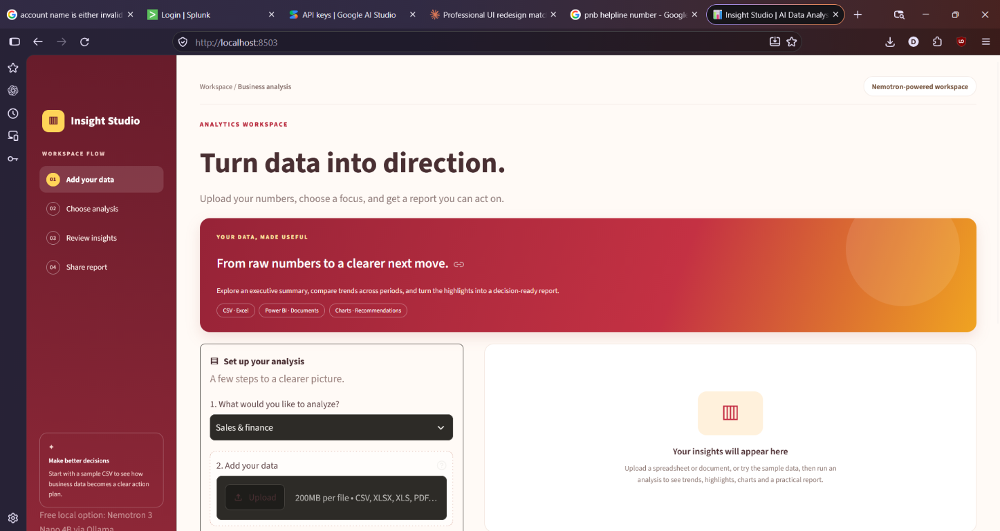
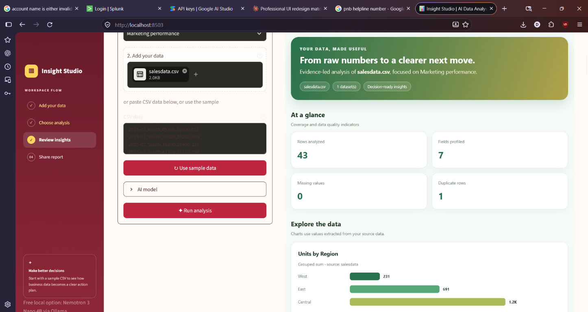
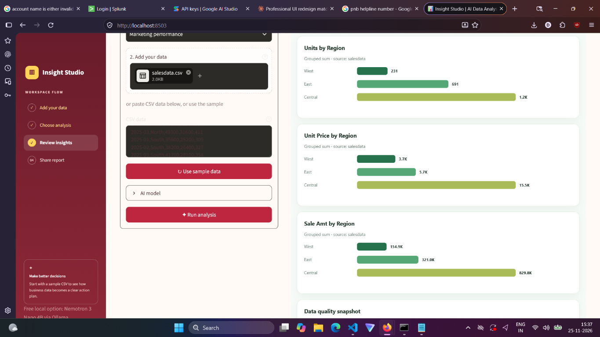

# Insight Studio

Insight Studio is a Streamlit app for turning spreadsheets and business
documents into an evidence-based analysis, a themed HTML dashboard, and
downloadable reports. It calculates data profiles locally and can use
NVIDIA-hosted Nemotron or a local Nemotron model through Ollama to write the
narrative.

> **Privacy note:** When NVIDIA-hosted Nemotron is selected, extracted dataset
> context is sent to NVIDIA for analysis. Use Ollama for local inference when
> data must remain on your machine.

## Screenshots

### Start screen



### Dashboard overview



### Charts and detailed dashboard



## Example results

The screenshots show an example analysis of `salesdata.csv`. The dashboard
reported **43 rows**, **7 fields**, **0 missing values**, and **1 duplicate
row**. Its regional charts summarized units, unit price, and sales amount; for
example, the units chart showed about **1.2K** for Central, **691** for East,
and **231** for West. These figures describe the screenshot's example input,
not a performance guarantee or a result for other uploaded files.

For each analysis, the app calculates dataset profiles and asks the selected
model to produce a report with:

- Executive summary and dataset scope
- Key findings, trends, and comparisons
- Interpretation of the available charts and visuals
- Risks, anomalies, and data-quality observations
- Evidence-linked recommendations
- Limitations and assumptions

The dashboard also presents data-quality indicators and charts built from the
uploaded data. The narrative is instructed to distinguish evidence from
hypotheses and to call out unsupported conclusions.

## Features

- Upload CSV, Excel (`.xlsx`, `.xls`), PDF, Word (`.docx`), PowerPoint
  (`.pptx`), text, Markdown, Power BI (`.pbix`), or Power BI template
  (`.pbit`) files.
- Paste CSV data or start with the built-in sample dataset.
- Select an analysis focus such as sales and finance, operations, marketing,
  customer/product trends, workforce, or a general overview.
- Generate an HTML dashboard using one of five randomly selected themes.
- Export the result as HTML, PowerPoint, PDF, or Word. Export filenames use the
  source filename, for example `Cars_Sales_Analysis_Report.pptx`.
- Convert a standalone HTML dashboard to PowerPoint.
- Use a hosted NVIDIA Nemotron model or run the local Nemotron 3 Nano 4B model
  with Ollama.

## AI model options

### NVIDIA-hosted Nemotron

The hosted option currently targets
`nvidia/nemotron-3.5-super-vl-120b-a12b` through NVIDIA's OpenAI-compatible
API. It requires an NVIDIA API key and is subject to the provider's availability,
rate limits, and terms. The current request sends the extracted text and
calculated data context; uploaded image payloads are not sent as vision input.

### Local Nemotron with Ollama

Ollama runs inference on your own computer without a hosted API key. Install
[Ollama](https://ollama.com/) and pull the model:

```powershell
ollama pull nemotron-3-nano:4b
```

Keep Ollama running while using the app, then select **Ollama (local Nemotron)**
in the AI model settings. Generation speed depends on your computer's hardware.

## Run locally

Use Python 3.10 or later. From the project directory:

```powershell
python -m venv .venv
.\.venv\Scripts\Activate.ps1
python -m pip install -r requirements.txt
streamlit run app.py
```

Open the local URL printed by Streamlit (usually
`http://localhost:8501`). If that port is already in use, Streamlit will select
another available port.

### Configure the NVIDIA key locally

For local Streamlit development, copy the example secrets file and replace the
placeholder with your key:

```powershell
Copy-Item .streamlit\secrets.toml.example .streamlit\secrets.toml
```

Edit `.streamlit/secrets.toml`:

```toml
NVIDIA_API_KEY = "your-real-key"
```

Alternatively, set `NVIDIA_API_KEY` in your process environment or enter it in
the app's password field. The local secrets file is excluded by `.gitignore`;
never commit a real key.

## Deploy to Streamlit Community Cloud

1. Push the project source to a GitHub repository. Do not include `.env`,
   `.streamlit/secrets.toml`, virtual environments, or API keys.
2. In [Streamlit Community Cloud](https://share.streamlit.io/), create an app
   from the repository and set its main file to `app.py`.
3. Open the app's **Settings → Secrets** and add:

   ```toml
   NVIDIA_API_KEY = "your-real-key"
   ```

4. Save the secret and deploy or reboot the app. The app reads the key from
   `st.secrets` when no key is entered in the UI.

The example configuration is in
[`.streamlit/secrets.toml.example`](.streamlit/secrets.toml.example).

## Supported inputs and limitations

- **CSV and Excel:** calculates row/column counts, missing and duplicate
  values, numeric distributions, category summaries, and correlations where
  applicable. Excel workbooks can be analyzed sheet by sheet.
- **PDF, Word, PowerPoint, text, and Markdown:** extracts available text and
  tables; PowerPoint chart series may also be read where supported.
- **Power BI `.pbix` and `.pbit`:** inspects report page and visual layout
  metadata. It does not extract the proprietary embedded VertiPaq model or
  underlying row-level figures. Export data from Power BI to CSV/Excel, or
  export a report to PDF/PowerPoint, for data-backed analysis.
- **Scanned PDFs and image-only charts:** require OCR or text/data export. The
  current model request is text-based and does not provide image understanding
  for uploaded source images.

Treat AI-generated interpretations as decision support and verify important
findings against the source data.

## Project layout

| File or directory | Purpose |
| --- | --- |
| `app.py` | Streamlit interface, analysis workflow, secrets lookup, and downloads |
| `analyzer.py` | File parsing and calculated data profiles |
| `dashboard_generator.py` | Themed HTML dashboard generation |
| `llm_providers.py` | Ollama and NVIDIA-hosted Nemotron integrations |
| `report_generator.py` | PowerPoint, PDF, and Word generation |
| `requirements.txt` | Runtime dependencies |
| `docs/screenshots/` | Screenshots embedded in this README |

## License

No license is currently specified. Add a license before publishing if you want
to grant others permission to reuse or distribute the project.
